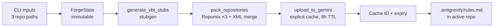

# Context Forge ⚒️

**A split-state, functional orchestrator that prepares large codebases for Gemini 3 context caching.**

Context Forge takes the three codebases a quant developer actually works with — their own strategy repo, a huge proprietary library, and a TypeScript charting library — shrinks each one with a strategy suited to it, merges them into a single structured context, and uploads that context to Google's Gemini Context Cache. It then writes the resulting cache ID into the active repo's IDE rules file so the coding assistant can pick it up.

> **Status:** early prototype (v0.1.0). Best read as a design study in functional pipeline architecture applied to an LLM-tooling problem. See [Project status](#project-status) for what has and hasn't been verified.

---

## The problem

LLM coding assistants work best when they can see the APIs they're writing against. For a quant workflow that means:

- **VectorBT Pro** is a large, Numba-heavy library. Its raw source is expensive in tokens and confusing to a model because of JIT compilation and dynamic dispatch, yet the model really only needs the *signatures*.
- **Lightweight Charts** is a TypeScript library whose public interfaces matter far more than its internals.
- **The active strategy repo** is the code being edited, so it needs full fidelity, comments included.

Pasting all three in verbatim wastes the context window. Dropping them means the model guesses at APIs. Context Forge treats this as a *compression-per-role* problem: each repo gets the cheapest representation that still preserves what the model needs from it.

## How it works

Each repository is assigned a **role** and a **strategy**:

| Repository | Role | Strategy | Tooling | What survives |
|---|---|---|---|---|
| Active strategy repo | read/write | `full` | Repomix | Everything, including comments |
| VectorBT Pro | read-only reference | `stub` | `mypy stubgen` → Repomix | Type signatures (`.pyi`), no implementation |
| Lightweight Charts | read-only reference | `compress` | Repomix `--compress` (Tree-sitter) | TypeScript interfaces and JSDoc, logic removed |

The pipeline then runs three stages:



The merged context is a single XML document whose structure tells the model what each section *is*:

```xml
<context_root>
  <library name="vectorbtpro" type="stubbed_reference">…</library>
  <library name="lightweight-charts" type="compressed_reference">…</library>
  <workspace name="active_repository" type="full_fidelity">…</workspace>
</context_root>
```

The cache is created with a system instruction that frames the model as a principal quant engineer with read-only access to the libraries and a working copy in `<workspace>`, and a time-to-live of eight hours, sized to a working day.

## Design highlights

The interesting part of this project is how it is built, not just what it does.

**Split-state, functional architecture.** The code is divided into two packages with a hard boundary:

- `core/` holds pure data: `ForgeState` and `RepoConfig`, both frozen Pydantic models. No I/O happens here.
- `ops/` holds the side-effecting stages (subprocess calls, filesystem, network). Each is a function of the shape `ForgeState -> ForgeState`.

**Immutable state as the single source of truth.** `ForgeState` captures everything about a run at a point in time: inputs, intermediate artifact paths, remote cache metadata, logs, and any error. Stages never mutate it; they return a modified copy via `model_copy`. That makes every step easy to reason about and test in isolation.

**Pipeline composition with `toolz.pipe`.** The whole program is one expression:

```python
final_state = pipe(initial_state, generate_vbt_stubs, pack_repositories, upload_to_gemini)
```

**Railway-style short-circuiting without exceptions as control flow.** Every stage begins with `if not state.is_valid: return state`. A failure calls `state.fail(...)`, which records the error and lets the remaining stages pass the state through untouched. The CLI inspects the final state once, prints the accumulated logs, and exits non-zero on error. There is no scattered try/except in the orchestration layer.

**Honest diagnostics.** Progress is recorded in the state's log trail rather than printed from inside stages, so the CLI decides how to render success and failure (via `rich`).

## Tech stack

Python 3.11+ · Pydantic v2 · toolz · Typer · Rich · mypy/stubgen · Repomix (Node) · Google GenAI SDK (Gemini context caching)

## Project structure

```
context-forge/
├── pyproject.toml                 # Poetry config; exposes the `forge` command
└── src/context_forge/
    ├── main.py                    # Typer CLI: builds initial state, runs the pipeline, writes IDE rules
    ├── core/
    │   └── state.py               # ForgeState and RepoConfig (frozen Pydantic models)
    └── ops/
        ├── compression.py         # generate_vbt_stubs, pack_repositories
        └── gateway.py             # upload_to_gemini
```

## Installation

Requires Python 3.11+, Node.js (for Repomix), and a Google API key with access to Gemini context caching.

```bash
pip install poetry
poetry install
npm install -g repomix
export GOOGLE_API_KEY="your-key-here"
```

## Usage

```bash
poetry run forge \
  --active /path/to/my-strategy-repo \
  --vbt /path/to/directory-containing-vectorbtpro \
  --charts /path/to/lightweight-charts
```

On success the tool prints the cache name and expiry, and writes `.antigravity/rules.md` into the active repo with the cache ID and a summary of what was loaded.

### Notes

- **VectorBT path:** pass the directory that *contains* the `vectorbtpro` package folder. VectorBT Pro is proprietary, so you must supply your own licensed copy.
- **Node:** Repomix is invoked through `npx`, so Node.js must be on the `PATH`.
- **Scratch space:** stubs, per-repo XML and the merged context are written under `/tmp/forge`, so nothing is added to your repositories except `.antigravity/rules.md`.

## Project status

This is a v0.1.0 prototype. What has and hasn't been checked:

- **Verified:** the package installs and imports under the `src/` layout (with `google-genai` 2.x), the Gemini caching calls match the SDK's API, the stub-generation stage produces `.pyi` files from a package folder, and an invalid input short-circuits the pipeline with a clear error instead of crashing later stages.
- **Not yet run end to end:** the Repomix packing and Gemini upload stages need a licensed VectorBT Pro copy, Node, and a Google API key, so they have not been exercised against real repositories.
- **No automated tests yet.** The pure-function design is meant to make them straightforward.
- **Hard-coded Gemini model identifier** targeting a preview model, and token counts are estimated from character length rather than measured.

## Roadmap ideas

- Configurable repo targets instead of the fixed VectorBT / Lightweight Charts / active trio
- Real token counting before upload, with a budget guard
- Cache reuse and refresh when a cache is still live
- Unit tests for each stage using temporary directories and a mocked Gemini client

## Author

Built by [Ian Douglas](https://github.com/iancaseydouglas).
